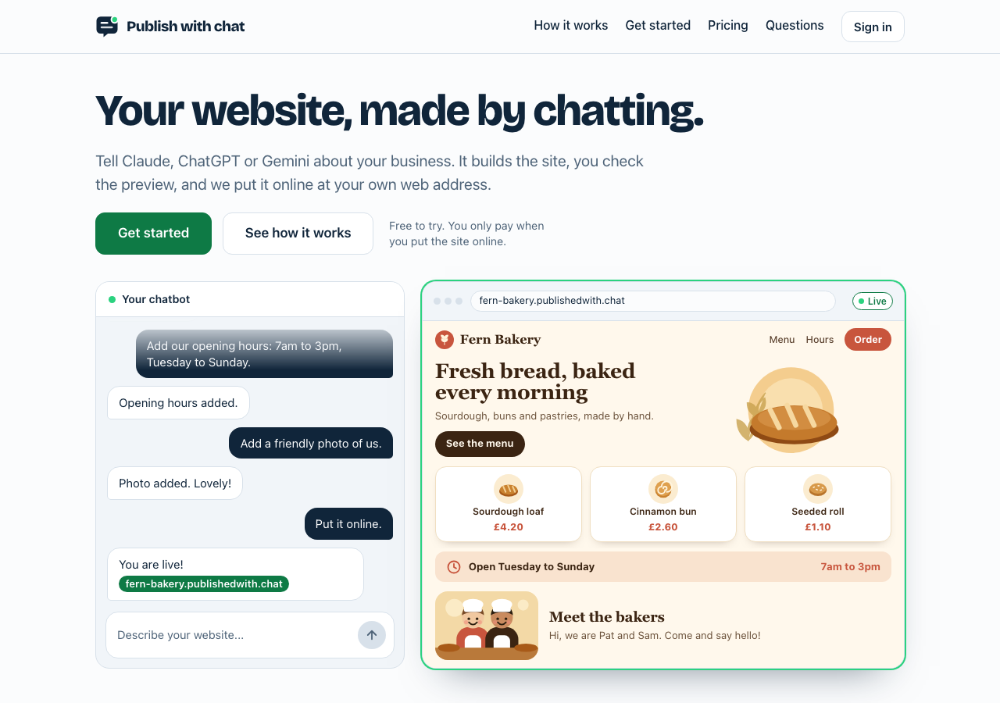
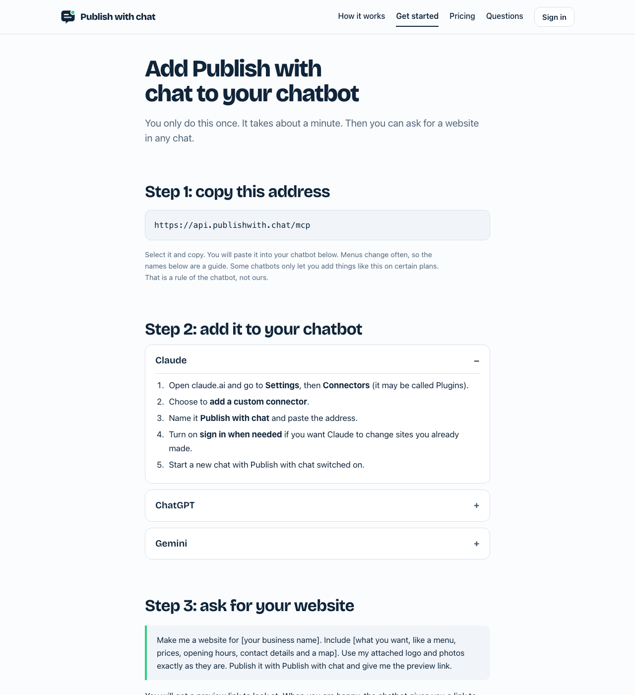

<p align="center">
  <picture>
    <source media="(prefers-color-scheme: dark)" srcset="assets/lockup-horizontal-reversed.svg">
    
  </picture>
</p>

<p align="center"><strong>Your website, made by chatting.</strong><br>
Tell Claude, ChatGPT or Gemini about your business. It builds the site, you check the preview, and it goes online at your own web address.</p>

<p align="center">
  <a href="https://publishwith.chat">Website</a> ·
  <a href="docs/connect.md">Add it to your chatbot</a> ·
  <a href="docs/prompts.md">Prompts</a> ·
  <a href="docs/troubleshooting.md">Troubleshooting</a> ·
  <a href="brand/">Brand pack</a>
</p>

<p align="center">
  
</p>

## How it works

1. **Add it once.** Paste the connector address into your chatbot. It takes about a minute.
2. **Ask for a website.** "Make me a website for my bakery, with a menu and opening hours."
3. **Check the preview.** Publish with chat checks the pages for errors and gives you a free preview link that lasts 48 hours.
4. **Put it online.** When you are happy, you sign in and the site goes live at its own address. You can connect your own domain too.
5. **Change it any time.** Ask the chatbot to change text, photos or pages. Every update is kept as a version you can switch back to.

Good for brochure sites, portfolios, menus, landing pages and event pages. Sites are static: no server code and no databases.

## Add it to your chatbot

Connector address (the same for every chatbot):

```
https://api.publishwith.chat/mcp
```

| Chatbot | Where to add it |
|---|---|
| Claude | Settings, Connectors, add custom connector |
| ChatGPT | Settings, Apps or Connectors, add custom connector |
| Gemini | gemini.google.com/devmode, create a new app |

Full steps for each, with the small things that trip people up, are in [docs/connect.md](docs/connect.md). Menus change often, so the names above are a guide.

<p align="center">
  
</p>

## Then ask

```
Make me a website for [your business name]. Include [what you want, like a menu,
opening hours, contact details and a map]. Use my attached logo and photos exactly
as they are. Publish it with Publish with chat and give me the preview link.
```

More ideas, and what to tell the chatbot for a better first preview, are in [docs/prompts.md](docs/prompts.md).

## What the connector can do

| Area | What you can ask for |
|---|---|
| Build | Create a site from text, add images and files, get a preview link |
| Go live | Check progress and put a previewed site online once your account is set up |
| Change | Edit text, images and pages on a site you own |
| Undo | List versions and switch back to an earlier one |

Tools that change or replace a live site are marked as such, so your chatbot asks you first.

## Privacy and safety

- We store the website files you give us and your email address. Payments are handled by Stripe and we never see card numbers.
- Uploads are checked for harmful content, and every site and preview has a report link.
- You can export your data and delete your sites or account at any time.
- [Privacy policy](https://app.publishwith.chat/privacy) and [terms](https://app.publishwith.chat/terms).
- Found a security problem? See [SECURITY.md](SECURITY.md).

## In this repository

| Folder | What is in it |
|---|---|
| [`docs/`](docs/) | Guides: connecting each chatbot, prompts, troubleshooting, screenshots |
| [`brand/`](brand/) | Logos, icons, social images and banners, with usage notes |
| [`scripts/`](scripts/) | A script that re-captures the screenshots from the live site |

The service itself is not open source. This repository is where we keep the public guides and assets.

## Help and feedback

- Something not working, or a chatbot we have not listed? [Open an issue](https://github.com/publishwithchat/publishwithchat/issues/new/choose).
- Want to improve a guide? See [CONTRIBUTING.md](CONTRIBUTING.md).
- Anything else: support@publishwith.chat.

---

Publish with chat is run by Philip Snelling trading as Conduit Digital, Cwmbran, Wales.
